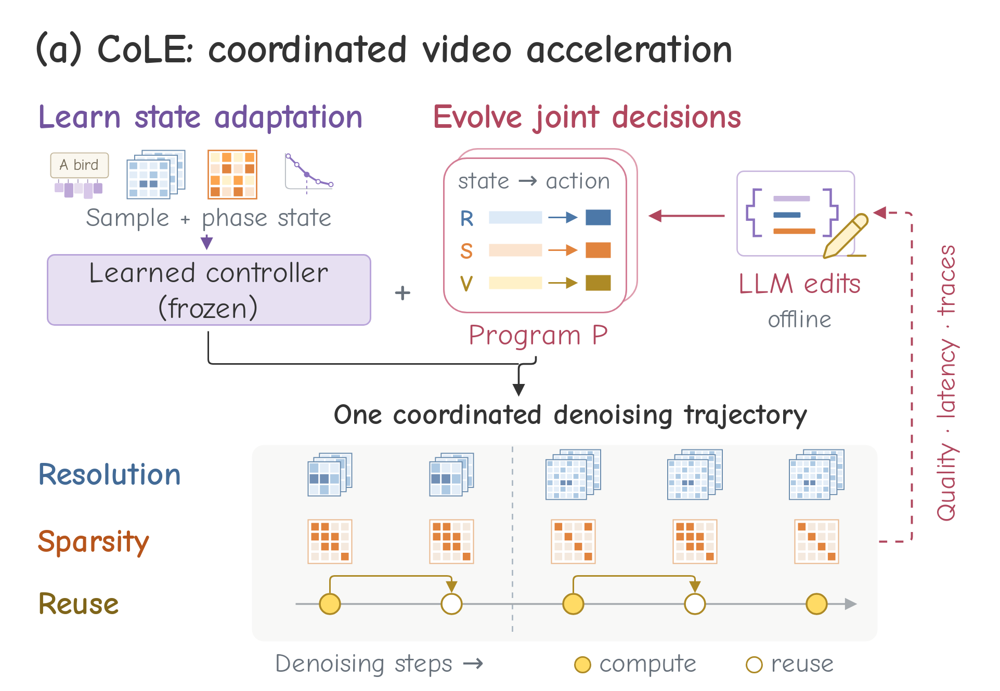
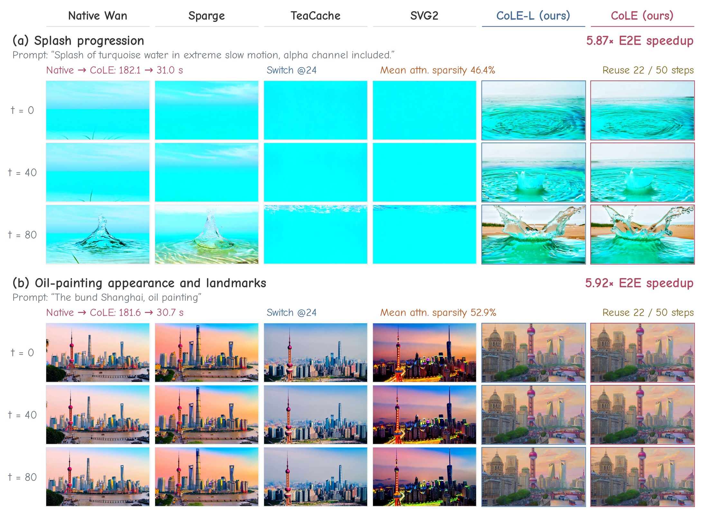

# CoLE

**Coordinated Learning and Evolution of Acceleration Policies for Video Diffusion**

CoLE coordinates resolution switching, sparse attention, and prediction reuse during denoising. CoLE-L learns all three decisions. CoLE runs the selected evolved program with a frozen controller.



## Results

In the paper's Wan2.1-T2V-1.3B benchmark, CoLE generates videos **5.91× faster** than Native Wan with a **0.185-point** decrease in VBench Total. Table 1 uses an RTX 5090, 946 prompts, and five shared seeds. End-to-end latency includes text encoding, generation, VAE decoding, and postprocessing.

| Method | VBench Total ↑ | Quality ↑ | Semantic ↑ | E2E (s) ↓ | Speedup ↑ |
| --- | ---: | ---: | ---: | ---: | ---: |
| Native Wan | 82.439 | 84.075 | 75.897 | 180.971 | 1.000× |
| CoLE-L | 82.274 | 83.999 | 75.374 | 43.292 | 4.180× |
| CoLE | 82.254 | 84.326 | 73.966 | 30.604 | 5.913× |



## Quickstart

### Install

The sparse backend targets NVIDIA `sm_120`. Use Python 3.12 and set `CUDA_HOME` to the CUDA 12.8 toolkit.

```bash
python -m pip install torch==2.11.0 --index-url https://download.pytorch.org/whl/cu128
python -m pip install -e .
python -m pip install einops ninja wheel
git clone https://github.com/thu-ml/SpargeAttn.git sparse-attention
git -C sparse-attention checkout ae5b629ebb41e41f86b3ea2ab5a3283f13ac151a
git -C sparse-attention apply ../patches/sparse-sm120.patch
TORCH_CUDA_ARCH_LIST=12.0 python -m pip install --no-build-isolation ./sparse-attention
python scripts/check_sparse.py --device cuda:0
```

### Download Wan2.1

```bash
hf download Wan-AI/Wan2.1-T2V-1.3B-Diffusers \
  --revision 0fad780a534b6463e45facd96134c9f345acfa5b \
  --local-dir models/wan21
```

### Generate a video

```bash
python scripts/run_cole.py \
  --model-dir models/wan21 \
  --prompt "A small sailboat crosses a calm lake at sunrise." \
  --seed 20260406 \
  --output-dir runs/demo
```

Find the video at `runs/demo/strategies/rollout_r00/demo/output.mp4`. CoLE loads the bundled controller and program by default. For CoLE-L, add `--variant cole-l --reuse-checkpoint PATH`. [Controller](checkpoints/wan21_controller.pt) · [Program](configs/wan21_program.json)

## Reproduce VBench

Generate one run per seed from `20260402` through `20260406`. To try a single case first, add `--prompt-id vbench_wan_official_temporal_flickering_0000`. [Prompt manifest](configs/vbench946.jsonl)

```bash
python scripts/run_cole.py --model-dir models/wan21 \
  --vbench --seed 20260406 --output-dir runs/vbench-20260406
```

Use a separate scoring environment with PyTorch and torchvision for the pinned VBench dependencies. [VBench setup](https://github.com/Vchitect/VBench/tree/45e79ec14e69a2187202c675d2dbce1a71843d53)

```bash
git clone https://github.com/Vchitect/VBench.git
git -C VBench checkout 45e79ec14e69a2187202c675d2dbce1a71843d53
python -m pip install -r VBench/requirements.txt

python scripts/score_vbench.py \
  --vbench_repo VBench \
  --vbench_cache_dir ~/.cache/vbench \
  --strategy_run CoLE=runs/vbench-20260406 \
  --output_root runs/vbench-20260406-scores
```

Average the five seed scores and multiply by 100 for the paper's reporting scale. The `summary.md` report includes end-to-end latency with text encoding.

## Acknowledgments

CoLE's `sparse` backend uses the SageAttention2++ top-k kernel distributed by SpargeAttention. The included build patch enables `sm_120` for that dependency. [Upstream code](https://github.com/thu-ml/SpargeAttn) · [SpargeAttention paper](https://arxiv.org/abs/2502.18137) · [SageAttention2++ paper](https://arxiv.org/abs/2505.21136) · [Upstream Apache-2.0 license](patches/SpargeAttention-LICENSE.txt)

The Wan runtime adapts the Wan implementation in Diffusers. [Upstream code](https://github.com/huggingface/diffusers/tree/v0.33.1/src/diffusers) · [Diffusers Apache-2.0 license](licenses/Diffusers-LICENSE.txt)
